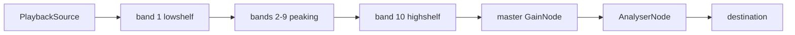

# Graph and lifecycle

## Signal graph (from `tech.md`)

An `AudioWorkletNode` goes where its function requires (before the EQ for input processing, or as a tap beside the analyser). Record the position in `docs/audio/`. Do not add nodes `tech.md` does not list without telling the architect.

## Context states

| State | Meaning | Engine action |
|---|---|---|
| `suspended` | Created without a gesture, or paused by the system | `resume()` from a user gesture; show a start prompt if needed |
| `running` | Rendering | Normal |
| `closed` | Terminal | Create a new engine |

Treat any other reported value as `suspended`.

## Engine transitions

| From | Event | To |
|---|---|---|
| idle, ready, paused, ended, error | `load(track)` | loading |
| loading | `loaded` | ready |
| loading | `loadFailed(reason)` | error |
| ready, paused, ended | `play` | playing |
| playing | `pause` | paused |
| playing | `sourceEnded` | ended |
| playing, paused, ready | `seek(t)` | same state, new position |
| any | `dispose` | idle, engine unusable |

Events with a stale load token are dropped. Anything not in the table returns the same state; the reducer never throws.

## Cleanup on track change
1. Stop the source and disconnect it from the first band.
2. Remove media element or source listeners.
3. Revoke object URLs for this track.
4. Release the previous `AudioBuffer` reference.
5. Reset position and pending tokens.

On dispose also: cancel animation frames, remove `statechange` and `visibilitychange` listeners, close worklet ports, disconnect persistent nodes, `close()` the context, mark the engine disposed.

## Assumptions to confirm
- The context exists only in the renderer. Output device selection is out of scope until requested.
- Sleep and device-change behavior differs per platform. Mark it VERIFIED only after a test or manual run.
