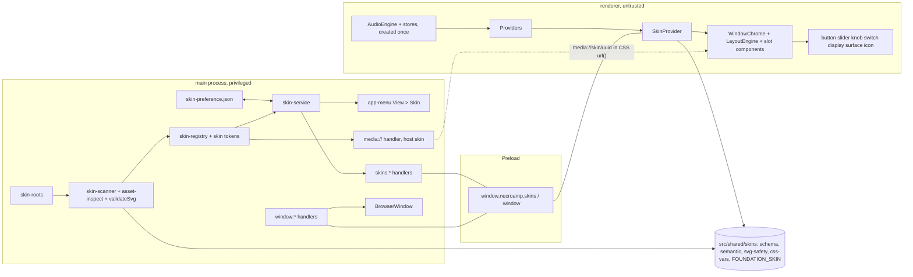

# Skin Engine: Design

Canonical source for `.kiro/specs/skin-engine/design.md`. Decisions: ADR 0007 (manifest, layout, variants), ADR 0008 (discovery, persistence, assets), ADR 0009 (frameless chrome), ADR 0010 (SVG). Exact contract: `docs/architecture/skin-engine-contract.md`.

## 1. Shape of the solution



Dependency direction is unchanged (`structure.md`): main, preload and renderer import `shared`; `shared/skins` imports only `zod`.

## 2. Key decisions (summary)

| Topic | Decision | ADR |
|---|---|---|
| Format | Strict JSON manifest, closed variant enums, named control styles, token map, asset keys; no CSS or code | 0007 |
| Layout | Named CSS grid regions, up to 4 width breakpoints, fit check at minimum size, decorative layers | 0007 |
| Foundation | Embedded manifest constant, permanent fallback, no I/O | 0007 |
| Packaging | Directory only, bundled root only | 0007 |
| Assets | `media://skin/<uuid>`, token-gated, re-validated at serve | 0008 |
| CSP | `img-src` and `font-src` gain `media://skin`, nothing else | 0008 |
| Persistence | `skin-preference.json`, atomic, fallback never rewrites | 0008 |
| Chrome | Frameless single window, trusted title bar, in-app menu bar plus native menu | 0009 |
| SVG | Pure allowlist validator, image-only rendering | 0010 |

## 3. Main process

Startup: existing protocol registration, then `skin-preference.load()`, `skin-scanner.scan(builtinRoot)`, `skin-service.init()`, then window creation with the active skin's size constraints (`buildWindowOptions(frameless, constraints)`). The service is the single authority. `skins:set-active` and the native menu both call `setActive`, which validates the id against the registry, swaps the active record, persists, updates menu radio checks and window minimum size, and pushes `skins:changed` when the change came from the menu. Tokens for a skin's assets are minted on first resolution and reused for the session. Window close clears all token stores.

Failure policy: any scanner exception for one skin marks only that skin `invalid`. A root that cannot be read yields an empty list (Foundation only). No exception text or path crosses IPC or reaches logs (codes only).

## 4. Renderer

```
main.tsx: createAudioEngine, stores (once) -> Providers (player, playlist, eq, processing)
  -> SkinProvider (get-active, apply vars and fonts, Foundation fallback boundary)
     -> AppFrame [data-skin] (app surface, decor layers)
        -> WindowChrome (title bar, window buttons, menubar)
        -> LayoutEngine (ResizeObserver -> variant -> grid via CSSOM)
           -> RegionFrame x N (surface, inset, heading) -> slot component
        -> SkinPicker (dialog, portal inside the root)
```

Slot components (`TransportSlot`, `SeekSlot`, `VolumeSlot`, `TrackInfoSlot`, `ArtworkSlot`, `EqualizerSlot`, `PlaylistSlot`, `VisualizationSlot`, `StatusSlot`) live in their feature folders, read stores through the existing hooks and choose a primitive and variant from `useSkin().manifest.components`. The current `PlayerRegion` is split into the transport, seek, volume, track-info and artwork slots, all using `use-player`. The visualizer draw function gains a presentation parameter object (style, bars, stops, colors) derived from `visualization`; the analyser settings stay in `renderer/audio`. The `needles` style computes two levels from low and high band energy of the same frequency data.

CSS: CSS Modules per primitive and slot, reading only `--na-*` variables and `data-*` attributes. Shapes are trusted `clip-path` polygons per enum. Nine-slice uses `border-image-source: var(--na-surface-<key>-frame-source)`. Decor motion uses trusted keyframes wrapped in `@media (prefers-reduced-motion: no-preference)`.

## 5. Resizing and density

Foundation becomes a compact player: title bar, then a top band (artwork, track info, transport, seek, volume), a middle band (playlist on the left, visualization and EQ on the right), and a status strip. Only the playlist body scrolls. Each skin's base variant must fit its `minSize` by the fit rule; wider variants add columns. Heights adapt through `fr` and `minmax` rows. QA checks overlap and scrollbars at three sizes per skin.

## 6. Security analysis (delta)

| Threat | Control |
|---|---|
| Skin executes code | No code fields; SVG allowlist; image-only SVG rendering; no `<style>` or `innerHTML`; CSSOM values built from validated primitives |
| Path traversal or escape | Path regex, per-segment `lstat`, `realpath` containment, re-check at serve |
| Resource exhaustion | Manifest, per-asset, total, count, dimension and SVG complexity limits |
| Exfiltration or tracking | No URL fields; CSS URLs only `media://skin/<uuid>`; CSP `connect-src 'none'`; SVG external references rejected |
| Unreadable or hidden focus | Contrast floors; no focus state in the schema; focus ring from tokens with minimum width 2 |
| Untrusted content in the default session (AE-04) | Skins never load as documents; `Sec-Fetch-Dest` guard; navigation guards unchanged |
| IPC abuse | Fixed channels, no arguments for window actions, `{ skinId }` only, sender validation, strict schemas both ways |

## 7. Testing strategy

Contract section 12 lists the file stems. Pure modules get unit and property tests; main modules use in-memory fs; renderer uses component tests with a fake bridge; E2E covers switching, continuity, persistence, fallback, window controls, menus and screenshots. Coverage thresholds stay as configured.

## 8. Ownership and hand-off

Contract section 1. Shared contracts land first in one orchestrator step. Then desktop-engineer, frontend-engineer and art-director work in parallel on disjoint paths. qa-engineer adds property and E2E tests and screenshots. security-reviewer reviews the diff and writes `docs/security/skin-engine-review.md`.

## 9. Open decisions touched

Resolved provisionally here, each still **needs human decision** for final closure: 6 (skin format), 7 (packaging: directory only), 8 (styling: CSS Modules plus variables, confirmed), 14 (artwork: hand-authored original SVG, MIT, no generators), 16 (frameless single window). Not touched: 9, 10, 11, 12, 15, 17.
